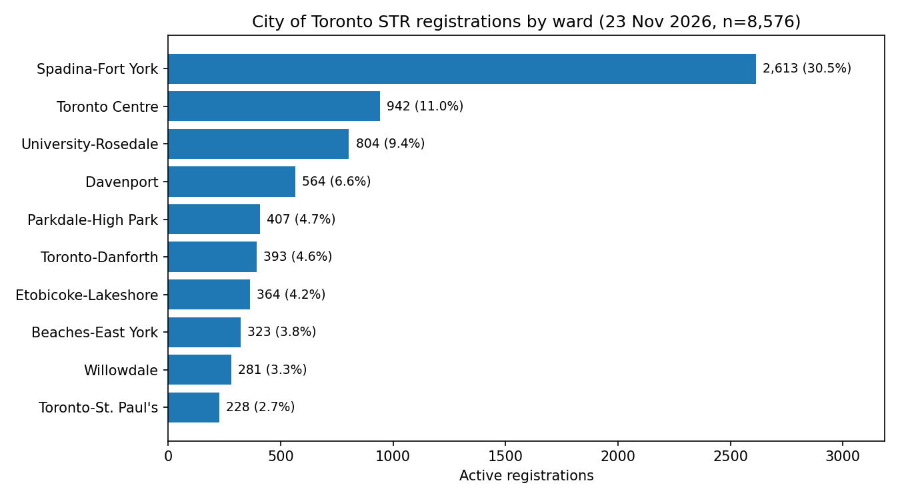

# Registered vs listed: City of Toronto STR registry against Inside Airbnb

**Sources:** City of Toronto Open Data, "Short Term Rentals Registration"
(downloaded 23 Nov 2026, dataset last refreshed 23 Nov 2026 15:00 UTC) vs
Inside Airbnb Toronto, September 2026 snapshot (scraped 17–18 Sep 2026).
Registry file: `data/str-registrations-2026-11-23.csv`.
AirDNA Toronto market page (updated 17 Nov 2026) used as a second denominator.

> **Verified figures.** Every number below was computed from the two source
> files named above. No figures are estimated or carried over from press
> coverage.

## Executive summary — 3 takeaways

1. **At most 38.9% of September's Airbnb listings could be registered.**
   The city registry holds 8,576 active registrations against 22,050 Airbnb
   listings in the September snapshot. That is an upper bound, not a
   compliance rate: the registry covers every platform (Airbnb, Vrbo, B&Bs),
   so the share of *Airbnb* listings that are registered is lower.
2. **The registered stock is the downtown condo stock.** Spadina-Fort York
   ward alone holds 30.5% of all registrations; the top 3 wards hold 50.8%.
   The top 8 addresses — all downtown condo towers — hold 18.0% of
   registrations between them.
3. **The two sources agree on where the market is, not how big it is.**
   Inside Airbnb's top neighbourhood is Waterfront Communities-The Island
   (2,946 listings, 17.6% of priced supply); the registry's top ward is
   Spadina-Fort York, which contains that same waterfront core. AirDNA's
   active-listing count (15,118, Oct 2026) sits between the two and implies
   a 56.7% registered share on its stricter "active" definition.

## 1. The registry at a glance

| | |
|---|---|
| Active registrations | 8,576 |
| Unique registration numbers | 8,576 (no duplicates) |
| Unique addresses | 4,915 (1.74 registrations per address) |
| Addresses with a unit number | 5,518 (64.3%) |
| Dataset refresh | Daily; this pull 23 Nov 2026 |

### Property mix

| Property type | Registrations | Share |
|---|---|---|
| Condominium | 3,584 | 41.8% |
| Single/Semi-detached House | 3,285 | 38.3% |
| Apartment | 676 | 7.9% |
| Townhouse / Row House | 582 | 6.8% |
| Duplex / Triplex / Fourplex | 448 | 5.2% |
| Single-family detached | 1 | 0.0% |

Condominiums plus apartments are 49.7% of the registry — the registered
market is roughly half multi-unit buildings, half houses. (Inside Airbnb's
cut is different — room type, not property type — so the two mixes are not
directly comparable: 67.9% of September listings were entire homes/apts and
31.7% private rooms.)

### Where the registrations are

| Ward | Registrations | Share |
|---|---|---|
| Spadina-Fort York | 2,613 | 30.5% |
| Toronto Centre | 942 | 11.0% |
| University-Rosedale | 804 | 9.4% |
| Davenport | 564 | 6.6% |
| Parkdale-High Park | 407 | 4.7% |
| Toronto-Danforth | 393 | 4.6% |
| Etobicoke-Lakeshore | 364 | 4.2% |
| Beaches-East York | 323 | 3.8% |

The top 3 wards hold 4,359 registrations (50.8%). The single largest
forward sortation area is M5V (downtown west core: CityPlace, Fort York,
King West) with 1,579 registrations (18.4%).

### The tower effect

| Address | Registrations |
|---|---|
| 251 Jarvis St | 285 |
| 300 Front St W | 257 |
| 21 Iceboat Ter | 207 |
| 14 York St | 193 |
| 101 Peter St | 166 |
| 151 Dan Leckie Way | 152 |
| 12 York St | 144 |
| 155 Yorkville Ave | 138 |

The top 8 addresses hold 1,542 registrations (18.0% of the registry).
Every one is a downtown condominium tower. Registration is concentrated
building by building, not spread evenly across the city.

### Registration cohorts

Registration numbers carry a `STR-YYMM-…` prefix that reads as the issue
year-month. 42.9% of active registrations carry a 2026 prefix, and the
single largest four-month cohort is March–June 2026 (2,158 registrations,
25.2% of the file). Caveat: whether numbers are reissued on renewal is not
stated in the dataset documentation, so treat these as issue cohorts, not
proof of when an operator first registered. The earliest prefixes in the
file are September 2020, when registration opened.

## 2. Registered vs listed — the comparison

| | Inside Airbnb (Sep 2026) | City registry (23 Nov 2026) | AirDNA (Oct 2026) |
|---|---|---|---|
| Universe | Airbnb listings scraped 17–18 Sep 2026 | Active registered operators, all platforms | Active listings, Airbnb + Vrbo + Booking.com, de-duplicated |
| Count | 22,050 | 8,576 | 15,118 |
| Registered share of Airbnb listings | — | **at most 38.9%** (8,576 / 22,050) | 56.7% on AirDNA's stricter active definition (8,576 / 15,118) |
| Geographic centre | Waterfront Communities-The Island, 2,946 (17.6% of priced supply) | Spadina-Fort York ward, 2,613 (30.5%) | — |
| Occupancy signal | Modelled calendar unavailability (upper bound only) | None — registration only | 72% actually booked (trailing 12 months), $122 ADR, $28.1K annual revenue per listing |

### Reading the 38.9% honestly

- It is an **upper bound**. The registry includes Vrbo-only operators and
  B&Bs, and some Airbnb listings in the September snapshot may since have
  left the platform. The true share of Airbnb listings that are registered
  is below 38.9%.
- The two counts are two months apart (September snapshot vs 23 November
  registry). Listings turn over; the gap is not a same-day audit.
- It is not a compliance rate for the city either: unregistered listings
  are not the same as illegal listings (some listings are exempt, some are
  inactive, some predate enforcement).
- What it does establish: **registered operators are a minority of the
  listing stock under any definition** — 38.9% against the full snapshot,
  56.7% against AirDNA's narrower active count.

## 3. What this adds to the dashboard

- A **compliance lens** the Inside Airbnb data cannot give on its own:
  registered operators vs listed supply, by ward and by building.
- A **second opinion on occupancy**: AirDNA's 72% actually-booked rate
  sits alongside the dashboard's modelled calendar-unavailability figures
  (an upper bound). The two should not be averaged; they answer different
  questions.
- A **daily-refreshing source** while Inside Airbnb is quarterly: the
  registry can be re-pulled any day, so the registered count stays current
  between Inside Airbnb releases.

## Next steps

- [ ] Decide whether to push this note + the registry CSV to the repo
  (`gh_push_airbnb.py`).
- [ ] Decide whether the registered-vs-listed comparison becomes a
  dashboard section (ward chart + coverage callout) or stays a standalone
  note.
- [ ] Re-pull the registry with the December Inside Airbnb release and
  re-run the comparison on a same-month basis.
- [ ] Confirm with the dataset documentation whether registration numbers
  are reissued on renewal (settles the cohort reading in §1).
